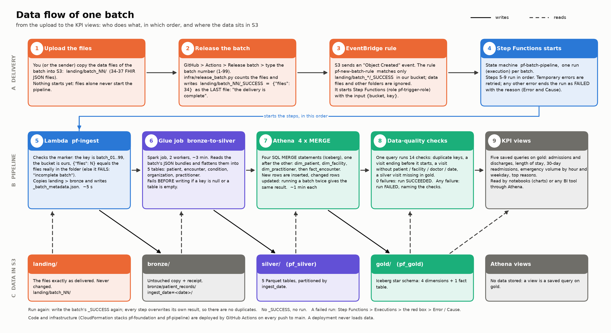
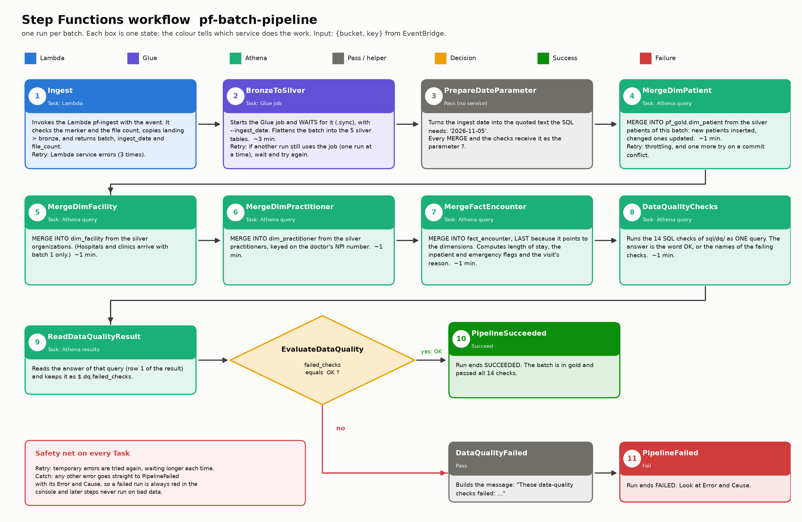
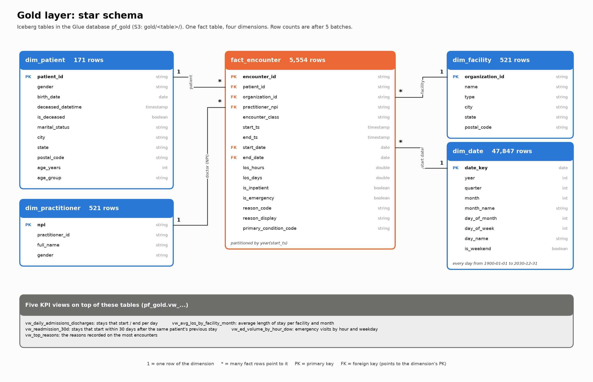

# Hospital Patient-Flow Lakehouse on AWS

A data pipeline on AWS. Synthetic hospital records (FHIR JSON, made with Synthea) arrive in batches. When a batch's `_SUCCESS` file appears in S3, the pipeline starts by itself, flattens the data into **bronze / silver / gold** layers, runs 14 data-quality checks and publishes a star schema with five patient-flow KPIs (admissions and discharges, length of stay, 30-day readmissions, emergency volume, top reasons).

The infrastructure is CloudFormation, deployment is GitHub Actions without any stored AWS key, and the whole system is explained in one document: **[docs/DOCUMENTATION.md](docs/DOCUMENTATION.md)**.

## How it works







---

## Set it up from scratch (new AWS account, new project)

You need: an AWS account, a GitHub account, and about 1.5 hours the first time. Everything below runs from the project folder.

### Words used in the commands

| Written like this | Means | Example |
|---|---|---|
| `<LAKE_BUCKET>` | a bucket name **you choose**; it must be unique in all of AWS | `patientflow-datalake-k3x9` |
| `<RESULTS_BUCKET>` | a second bucket name you choose | `patientflow-athena-results-k3x9` |
| `<OWNER>`, `<REPO>` | your GitHub user (or organisation) and repository name | `my-user`, `my-pipeline` |
| `<SUBJECT>` | the login identity GitHub sends to AWS (step 6a shows how to build it) | `repo:my-user@123/my-pipeline@456:ref:refs/heads/main` |
| `<ACCOUNT_ID>` | your 12-digit AWS account id | `aws sts get-caller-identity --query Account --output text` |

### 1. Install the tools

| Tool | Why | Install (Windows / macOS) | Check |
|---|---|---|---|
| Python 3.12 | all the code | python.org, or `winget install Python.Python.3.12` / `brew install python@3.12` | `python --version` |
| AWS CLI v2 | talks to AWS | `winget install Amazon.AWSCLI` / `brew install awscli` | `aws --version` |
| Git | version control | `winget install Git.Git` / `brew install git` | `git --version` |
| Java 17 (JDK) | the Spark tests and the Synthea data generator | `winget install Microsoft.OpenJDK.17` / `brew install openjdk@17` | `java -version` |

Close and reopen the terminal after installing, so the new programs are found.

### 2. Get the code and create the Python environment

```
git clone https://github.com/<OWNER>/<REPO>.git
cd <REPO>

python -m venv .venv
.venv\Scripts\Activate.ps1          # Windows PowerShell      (macOS/Linux: source .venv/bin/activate)
pip install -r requirements.txt
```
`.venv` is an isolated copy of Python with this project's libraries, so nothing else on your computer is touched. If you start from a plain copy of the files instead of a clone, create an empty repository on GitHub first and push to it; step 6a needs it.

### 3. Connect to your AWS account

```
aws configure
```

| It asks | You type | Where to find it |
|---|---|---|
| `AWS Access Key ID` | the key id of your IAM user | AWS console > IAM > Users > your user > **Security credentials** > Create access key |
| `AWS Secret Access Key` | the secret shown once, when you create the key | the same screen (copy it then; it cannot be shown again) |
| `Default region name` | `us-east-1` | this project is built for `us-east-1` |
| `Default output format` | `json` | |

The IAM user needs permission to create the resources of step 6 (for a personal learning account, the `AdministratorAccess` policy). Check that it works:
```
aws sts get-caller-identity
```
It prints your user and account id. **Never commit the keys**; `config/settings.json`, `.env` and `*credentials*` are in `.gitignore`.

### 4. Fill in the settings

```
copy config\settings.example.json config\settings.json        (macOS/Linux: cp config/settings.example.json config/settings.json)
```
Open `config/settings.json` and replace:

| Key | Put | Where to find it |
|---|---|---|
| `lake_bucket` | `<LAKE_BUCKET>` | you choose it (lowercase letters, digits, hyphens) |
| `athena_results_bucket` | `<RESULTS_BUCKET>` | you choose it |
| `github_repository` | `<OWNER>/<REPO>` | the URL of your GitHub repository |
| `github_subject` | `<SUBJECT>` | step 6a |
| `first_ingest_date` | `2026-11-01` | keep it (batch 1 gets this date, batch N gets this date + N-1 days) |

Every other key can stay as it is (see section 11 of the documentation).

**A budget alert (recommended).** One command makes AWS email you when the monthly cost passes $5, $20 and $50:
```
copy infraudget
otifications.example.json infraudget
otifications.json     (macOS/Linux: cp ...)
```
Open `infra/budget/notifications.json` and put your email address in place of `you@example.com` (that file is in `.gitignore`), then:
```
aws budgets create-budget --account-id <ACCOUNT_ID> --budget file://infra/budget/budget.json --notifications-with-subscribers file://infra/budget/notifications.json
```

### 5. Check the code on your computer

```
python -m ruff check .
cfn-lint infra/cloudformation/*.yaml
python -m pytest
```
All three must pass (220+ tests; the Spark tests need Java 17).

### 6. Create the infrastructure

**6a. The GitHub login identity.** GitHub proves who runs a deployment with a token whose *subject* AWS compares with the one you allow. Build it from the numeric ids of your repository:
```
curl https://api.github.com/repos/<OWNER>/<REPO>
```
(In Windows PowerShell write `curl.exe`.) Read `"id"` (the repository) and, inside `"owner"`, `"id"` (the owner), then:
```
<SUBJECT> = repo:<OWNER>@<OWNER_ID>/<REPO>@<REPO_ID>:ref:refs/heads/main
```
Older repositories may send `repo:<OWNER>/<REPO>:ref:refs/heads/main` (without ids). If the first deployment later fails at "Log in to AWS" with *Not authorized to perform sts:AssumeRoleWithWebIdentity*, open CloudTrail (event `AssumeRoleWithWebIdentity`) to read the exact subject GitHub sent, put that into the stack parameter and deploy `pf-cicd` again.

**6b. The CI/CD stack** (the roles GitHub uses). Your account can have only one GitHub login provider. Check:
```
aws iam list-open-id-connect-providers
```
If a provider ending in `token.actions.githubusercontent.com` is listed, copy its ARN into `OidcProviderArn=` below; if the list is empty, leave that parameter out and the stack creates it.
```
aws cloudformation deploy --stack-name pf-cicd ^
  --template-file infra/cloudformation/github_oidc.yaml ^
  --capabilities CAPABILITY_NAMED_IAM ^
  --parameter-overrides ProjectPrefix=pf LakeBucketName=<LAKE_BUCKET> ResultsBucketName=<RESULTS_BUCKET> ^
      GitHubSubject="<SUBJECT>" OidcProviderArn=<PROVIDER_ARN>
```
(`^` continues a command on the next line in Windows `cmd`; use `\` on macOS/Linux and `` ` `` in PowerShell.) `--capabilities CAPABILITY_NAMED_IAM` is your confirmation that the stack may create IAM roles with fixed names.

Read the two role ARNs it created (you need them in steps 6c and 7):
```
aws cloudformation describe-stacks --stack-name pf-cicd --query "Stacks[0].Outputs" --output table
```

**6c. The foundation and the pipeline.** One command deploys the buckets, the catalog, the workgroup and the roles (`pf-foundation`), uploads the code, and deploys the Lambda, Glue job, workflow and trigger (`pf-pipeline`). It uses the CloudFormation role from 6b, not your own permissions:
```
python -m infra.github_actions.deploy_stacks --version first --role-arn arn:aws:iam::<ACCOUNT_ID>:role/pf-cloudformation-role
```
`--version` is just a name for this deployment (GitHub uses the Git commit id).

**6d. The gold tables and the KPI views** (once):
```
python -m infra.operations.create_gold_tables
```

### 7. Connect GitHub

In your repository: **Settings > Secrets and variables > Actions > Variables** (not *Secrets*) > New repository variable:

| Name | Value | Where to find it |
|---|---|---|
| `AWS_DEPLOY_ROLE_ARN` | `arn:aws:iam::<ACCOUNT_ID>:role/pf-github-deploy-role` | `DeployRoleArn` output of `pf-cicd` (6b) |
| `AWS_CLOUDFORMATION_ROLE_ARN` | `arn:aws:iam::<ACCOUNT_ID>:role/pf-cloudformation-role` | `CloudFormationRoleArn` output of `pf-cicd` |
| `AWS_REGION` | `us-east-1` | |
| `LAKE_BUCKET` | `<LAKE_BUCKET>` | your settings |
| `RESULTS_BUCKET` | `<RESULTS_BUCKET>` | your settings |
| `SILVER_DATABASE` | `pf_silver` | |

Then `git push`. The **Deploy** workflow (Actions tab) runs the checks and redeploys the stacks. It must end green.

### 8. Make the data and load it

```
curl.exe -L -o data_generation/synthea-with-dependencies.jar https://github.com/synthetichealth/synthea/releases/download/master-branch-latest/synthea-with-dependencies.jar
java -jar data_generation/synthea-with-dependencies.jar -p 300 -s 42 -cs 42 --exporter.years_of_history 5 Massachusetts
python data_generation/split_batches.py
```
(macOS/Linux: `curl` instead of `curl.exe`.) The second command creates about 341 patient files in `output/fhir/` (`-p` population, `-s` and `-cs` seeds so the result can be reproduced, 5 years of history, the state of Massachusetts). The third splits them into 10 batches, `data/landing/batch_01 ... batch_10` (the hospital and doctor files go into batch 1).

Upload the batches. Files alone start nothing:
```
aws s3 sync data/landing s3://<LAKE_BUCKET>/landing/
```
Release batch 1 (the pipeline starts and takes about 9 minutes):
```
python -m infra.github_actions.release_batch --batch 1
```
or on GitHub: **Actions > Release batch > Run workflow > type `1`**. Release the other batches the same way, one at a time.

### 9. Check that it worked

```
aws stepfunctions list-executions --state-machine-arn arn:aws:states:us-east-1:<ACCOUNT_ID>:stateMachine:pf-batch-pipeline --max-results 3
```
`status: SUCCEEDED` means the whole batch is in gold. Then look at the data in the Athena console (workgroup `pf-wg`, database `pf_gold`):
```sql
SELECT COUNT(*) FROM pf_gold.fact_encounter;
SELECT * FROM pf_gold.vw_readmission_30d LIMIT 10;
```
Or run `notebooks/kpi_analysis.ipynb` (`jupyter notebook`) for the five charts.

---

## Everyday use

| I want to... | Do this |
|---|---|
| **Add batch 11** (or any new batch) | `aws s3 sync <folder of the files> s3://<LAKE_BUCKET>/landing/batch_11/`, then Actions > Release batch > `11` (or `python -m infra.github_actions.release_batch --batch 11`). No code change, no setting, no deployment. |
| Run a batch again | Release it again; the result is identical |
| See which batch a run was for | Step Functions > `pf-batch-pipeline` > Executions > the run > **Input** (`landing/batch_NN/_SUCCESS`) |
| Find why a run failed | Step Functions > the run > the red box > Error / Cause. Then, by step: Lambda log group `/aws/lambda/pf-ingest`; Glue console > Jobs > `pf-bronze-to-silver` > Runs; Athena console > Recent queries (workgroup `pf-wg`); `DataQualityFailed` names the failing check, whose SQL is in `sql/data_quality_checks/` |
| Pause the trigger | `aws events disable-rule --name pf-new-batch-rule` (`enable-rule` to resume) |
| Change code or infrastructure | Edit, `python -m pytest`, commit, `git push` to `main`: GitHub deploys it |
| Deploy from my laptop | `python -m infra.github_actions.deploy_stacks --version my-test --role-arn arn:aws:iam::<ACCOUNT_ID>:role/pf-cloudformation-role` |
| Roll back | Actions > Deploy > run it on an older commit |
| See what a full teardown would delete | `python -m infra.operations.teardown --plan` |
| **Delete everything** | `python -m infra.operations.teardown --delete-everything` (asks you to type the lake bucket name) |

**Cost:** one batch run is about **$0.03** (Glue). Athena is cents (a query that scans more than 1 GB is stopped). S3, Lambda, Step Functions, EventBridge and CloudFormation are about zero at this size. Create the budget alert above before you start.

## What each part is (short)

The folder tells you who uses the code; the file name tells you what it does.

| Path | Holds |
|---|---|
| `lambda/ingest/` | the ingest Lambda (landing to bronze, checks the delivery) |
| `glue_jobs/` | the silver job (`bronze_to_silver.py`) and its toolbox (`fhir_utils.py`) |
| `sql/gold/` | `create_tables/`, `merge_batch/` (the four `MERGE` statements), `kpi_views/` |
| `sql/data_quality_checks/` | the 14 quality checks, in `silver/` and `gold/` |
| `step_functions/` | the workflow definition |
| `infra/cloudformation/` | the infrastructure as YAML: `foundation.yaml`, `pipeline.yaml`, `github_oidc.yaml` |
| `infra/github_actions/` | what the GitHub workflows run: `deploy_stacks.py`, `release_batch.py` |
| `infra/operations/` | what you run by hand: `create_gold_tables.py`, `teardown.py` |
| `infra/shared/` | code the others import: `settings.py`, `pipeline_definitions.py`, `sql_files.py` |
| `infra/notebook_support/`, `infra/budget/` | helpers for the notebooks; the monthly budget |
| `notebooks/` | deploy and verify, run batches, data quality, KPI charts, explore the source data |
| `tests/` | the automatic tests, in folders that mirror the code |
| `.github/workflows/` | `ci.yml`, `deploy.yml`, `release-batch.yml` |
| `docs/DOCUMENTATION.md` | the full explanation: components, security, CI/CD, runbook, limits, glossary (with the full folder tree) |
