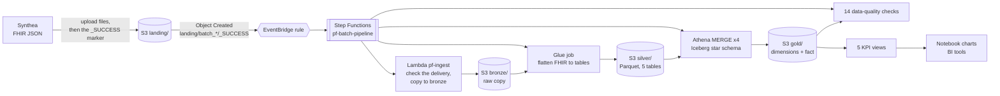
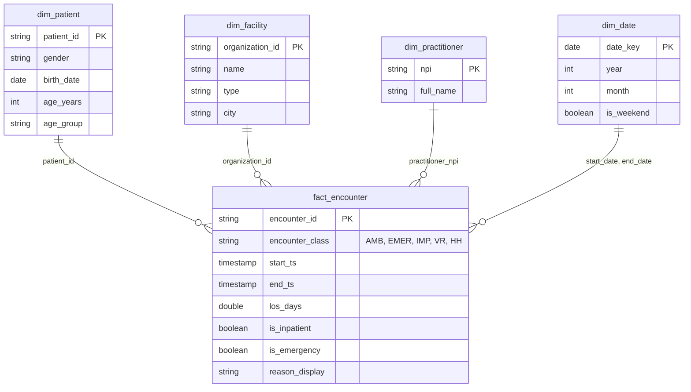

# Hospital Patient-Flow Lakehouse on AWS

An end-to-end data pipeline on AWS. Synthetic hospital records (FHIR, generated with Synthea) arrive as JSON files, move through a **bronze / silver / gold** lakehouse, are checked by 14 automatic data-quality rules, and end as a star schema with five patient-flow KPIs: admissions and discharges, length of stay, 30-day readmissions, emergency-department volume, and top reasons for visits.

Everything is code: the infrastructure is **CloudFormation**, the pipeline starts **by itself** when a delivery is complete, and **GitHub Actions** tests and deploys every change without any stored AWS key.

> Built step by step as a learning project. Every phase has a write-up in [docs/](docs/) and every AWS resource was first built by hand in a notebook (`notebooks/`) before it was moved into CloudFormation.

## Architecture

**One batch, in order** (a run takes about 9 minutes and costs about $0.03):

| # | Step | What happens |
|---|---|---|
| 1 | Delivery | The sender uploads the batch's files to `landing/batch_NN/`, then writes `_SUCCESS` containing the number of files, **last** |
| 2 | Trigger | S3 tells EventBridge; a rule that matches only `landing/batch_*/_SUCCESS` starts the Step Functions workflow |
| 3 | Ingest (Lambda) | Counts the files and compares with the marker (an incomplete delivery fails here), copies them to `bronze/…/ingest_date=…`, writes a receipt |
| 4 | Silver (Glue, Spark) | Reads the JSON bundles, flattens them into `patient`, `encounter`, `condition`, `organization`, `practitioner`, checks the tables, writes Parquet and registers the partition |
| 5 | Gold (Athena) | Four `MERGE` statements upsert the dimensions and then the fact table (Iceberg), so running a batch twice gives the same result |
| 6 | Quality | One query runs the 14 checks; any failure ends the run as `FAILED` and names the failing checks |

## Data model (gold)

The fact table is partitioned by the **year** of the visit (the data spans 1924-2026; month partitions would exceed Athena's limit of 100 open partition writers per query).

## KPIs

The five views in `pf_gold` (`sql/gold/views/`), charted in [`notebooks/kpi_analysis.ipynb`](notebooks/kpi_analysis.ipynb). The data is synthetic and small (4 batches: 137 patients, 521 facilities, 4,586 encounters), so the charts show how the output looks, not real hospital performance.

| | |
|---|---|
|  |  |
|  |  |
|  | |

The readmission KPI (17 readmissions within 30 days among 114 inpatient stays) was recounted independently from the source files in plain Python and matches.

## Quality: tests at every level

| Level | What | Where |
|---|---|---|
| Unit tests | 200+ tests: the Lambda with a fake S3, the silver flattening on a real local Spark, every SQL file, the workflow, the CloudFormation templates, the GitHub workflows | `tests/`, run by `pytest` |
| Lint | Python (`ruff`), CloudFormation (`cfn-lint`) | `ci.yml` |
| On AWS | each component has a notebook that builds it, tests the good case, the repeat and the bad cases (incomplete delivery, bad batch, two batches at once) and saves the output | `notebooks/` |
| In the pipeline | 14 data-quality checks run as the last step of every batch; `data_quality.ipynb` plants a bad row to prove they can fail | `sql/dq/` |

## Infrastructure as code and CI/CD

* `infra/cloudformation/foundation.yaml` – buckets, catalog, workgroup, the four service roles. `pipeline.yaml` – Lambda, Glue job, workflow, EventBridge rule. `github_oidc.yaml` – the roles for GitHub Actions.
* **Push to `main`** → `ci.yml` (lint + tests) → `deploy.yml` logs in to AWS with a short-lived OIDC token (no stored keys) and runs `infra/stacks.py`: deploy the foundation stack, upload the code under the commit id, deploy the pipeline stack. The Glue job and the Lambda always point at the code of one commit; to roll back, deploy an older commit.
* **Least privilege**: the role GitHub assumes can only hand work to CloudFormation and upload code. Only the CloudFormation role may create resources, and only the project's own names. The policy simulator checks this (`notebooks/cloudformation_stacks.ipynb`).
* Loading data is a separate, deliberate action: the **Release batch** workflow (or `notebooks/run_batches.ipynb`) writes the `_SUCCESS` marker for one batch.

## How to run it

Prerequisites: an AWS account, the AWS CLI configured for `us-east-1`, Python 3.12, Java 17 (for the Spark tests), and a GitHub repository for CI/CD.

1. `python -m venv .venv`, activate it, `pip install -r requirements.txt`.
2. Copy `config/settings.example.json` to `config/settings.json` and fill in your bucket names and GitHub repository.
3. Generate and split the data: `data_generation/` (Synthea, seed 42) – see [docs/phase_02_generate_explore_data](docs/phase_02_generate_explore_data/README.md).
4. Deploy: run `notebooks/cloudformation_stacks.ipynb` (or, once the CI/CD stack exists, push to `main`).
5. Load: run `notebooks/run_batches.ipynb`. It releases the four batches one at a time and checks the results.
6. Look: `notebooks/kpi_analysis.ipynb`, or query the views in Athena (`pf_gold.vw_…`, workgroup `pf-wg`).
7. Remove everything: `python infra/teardown.py --plan`, then `--delete-everything` ([docs/phase_14_teardown](docs/phase_14_teardown/README.md)).

The guide [docs/project_guide.md](docs/project_guide.md) explains every file and every AWS service in plain words.

## Cost

* One pipeline run: about **$0.03** (Glue, 2 workers for about 2 minutes). Athena is cents: the workgroup stops any query that scans more than 1 GB.
* Everything else (S3 at this size, Lambda, Step Functions, EventBridge, CloudFormation) is at or near zero.
* Guardrails: a $50 monthly budget alert, Glue job timeout of 10 minutes with no retries, Athena results deleted after 7 days.

## Lessons learned

* **A marker file beats "any new file".** A batch has 34-37 files; a trigger on each file would start the pipeline 37 times and the first run could see half a delivery. The `_SUCCESS` file carries the file count, so an incomplete delivery fails at the first step.
* **Make every step repeatable.** Overwrite-by-partition in silver and `MERGE` in gold mean a rerun gives the same result, so recovery is "run it again".
* **Test the failure paths, not only the happy path.** The bad batch, the incomplete delivery, two batches at once and the planted bad row each found something worth fixing (Glue's concurrency limit, Athena's header row on `SHOW`, Iceberg's partition-writer limit).
* **Keep the pure logic out of the cloud-only code.** The Glue script imports a toolbox (`fhir_utils.py`) that has no AWS inside, so 20 tests run it on a laptop with real Spark.
* **Athena `.sync` steps poll about once a minute**, so each merge costs about a minute in the workflow even when the query takes seconds.
* **Diagnose with the logs, not by guessing.** The GitHub login failed until CloudTrail showed the exact subject GitHub sends (it contains numeric ids).

## Future improvements

* Run the three dimension merges in a `Parallel` state (saves about two minutes per batch).
* Iceberg maintenance: `OPTIMIZE` and `VACUUM` on a schedule (every `MERGE` leaves old row versions).
* Write the data-quality results to a table to chart trends; alert on failure (SNS email).
* A quarantine folder so one bad file does not fail the whole batch.
* A BI report (Power BI or QuickSight) on the five views; a Redshift gold layer on a paid account; more sources (HL7 v2, an app, a website) with one rule and one workflow each.

## Repository map

| Folder | Holds |
|---|---|
| `lambda/ingest/` | the ingest Lambda |
| `glue_jobs/` | the silver job and its toolbox |
| `sql/gold/`, `sql/dq/` | table definitions, `MERGE` statements, KPI views, data-quality checks |
| `step_functions/` | the workflow definition |
| `infra/` | CloudFormation templates, deployment and teardown code, IAM policies, helpers |
| `notebooks/` | one notebook per component, run top to bottom with saved output |
| `tests/` | the automatic tests |
| `docs/` | one write-up per phase and the guides |
| `.github/workflows/` | CI, deployment, release-batch |
