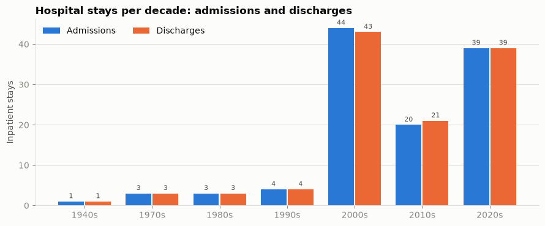
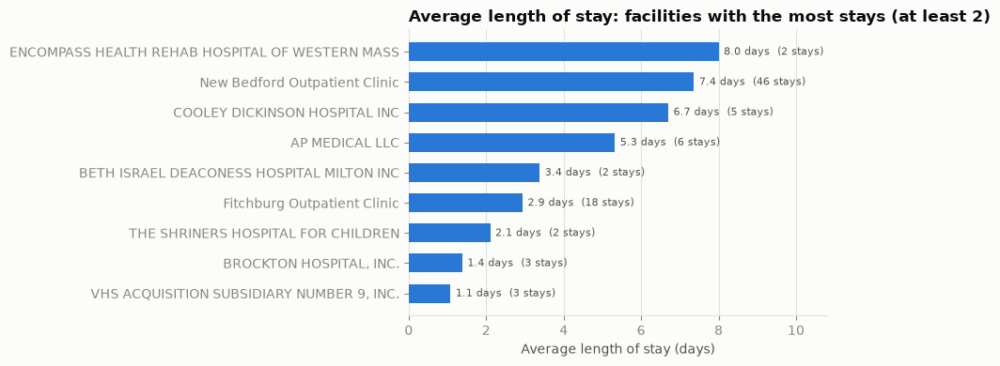
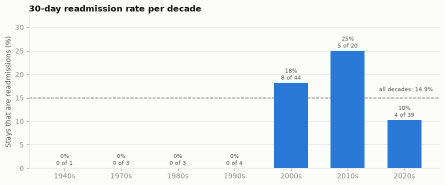
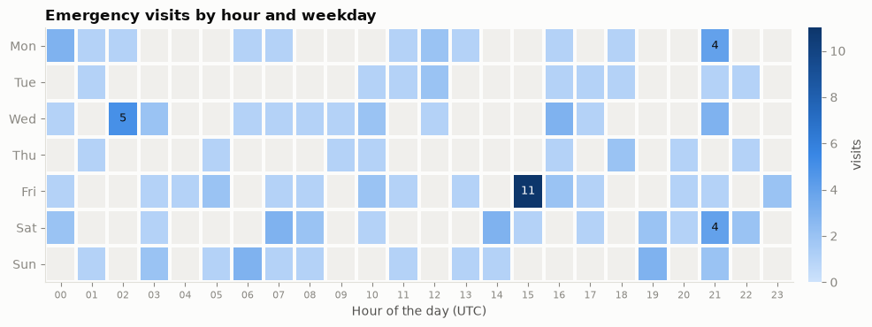
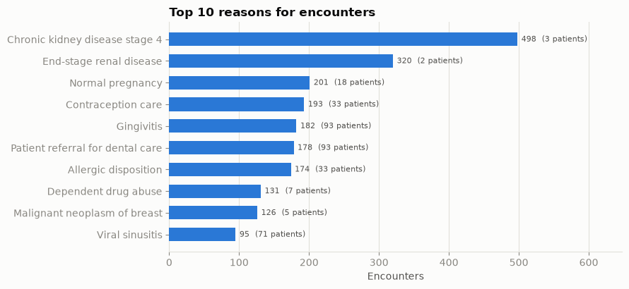

# Hospital Patient-Flow Lakehouse: full documentation

One document that explains the whole system: what it does, how the data moves, what every component does, how it is built and deployed, and what to do when something goes wrong. It is written for someone who has never seen the project.

**Contents**
1. [What it is](#1-what-it-is)
2. [The data flow, step by step](#2-the-data-flow-step-by-step)
3. [How a batch is delivered (the `_SUCCESS` marker)](#3-how-a-batch-is-delivered-the-_success-marker)
4. [Where the data lives (S3 layout and layers)](#4-where-the-data-lives-s3-layout-and-layers)
5. [The components in detail](#5-the-components-in-detail)
6. [The gold layer (star schema) and the KPIs](#6-the-gold-layer-star-schema-and-the-kpis)
7. [The Step Functions workflow](#7-the-step-functions-workflow)
8. [Data quality checks](#8-data-quality-checks)
9. [Infrastructure as code (CloudFormation) and security](#9-infrastructure-as-code-cloudformation-and-security)
10. [CI/CD with GitHub Actions](#10-cicd-with-github-actions)
11. [Configuration](#11-configuration)
12. [Operating the pipeline (runbook)](#12-operating-the-pipeline-runbook)
13. [Testing](#13-testing)
14. [Design decisions and known limits](#14-design-decisions-and-known-limits)
15. [Repository map](#15-repository-map)
16. [Glossary](#16-glossary)
17. [Build notes: how each part was built and tested](#17-build-notes-how-each-part-was-built-and-tested)

---

## 1. What it is

An end-to-end data pipeline on AWS (region `us-east-1`). Synthetic hospital records (FHIR JSON, generated with Synthea) arrive in batches. The pipeline cleans them layer by layer (bronze, silver, gold), checks the result with 14 automatic rules, and publishes a star schema with five patient-flow KPIs:

| KPI | Question it answers | View |
|---|---|---|
| Admissions and discharges | How many hospital stays start and end each day? | `vw_daily_admissions_discharges` |
| Length of stay | How long do patients stay, per facility and month? | `vw_avg_los_by_facility_month` |
| 30-day readmissions | How many stays start within 30 days after the same patient's previous stay? | `vw_readmission_30d` |
| Emergency volume | When do emergency visits happen (hour of day x weekday)? | `vw_ed_volume_by_hour_dow` |
| Top reasons | Why do patients come? | `vw_top_reasons` |

The data is synthetic (Massachusetts, 341 patients, up to 10 batches, visits from 1924 to 2026), so the numbers show how the pipeline's output looks, not real hospital performance.

Three properties make the design worth studying:
* **Event-driven.** Nobody presses "run". A batch starts the pipeline when its delivery is complete.
* **Repeatable.** Every step overwrites its own result, so running a batch twice gives the same tables and no duplicates.
* **Everything is code.** The infrastructure is CloudFormation, deployment is GitHub Actions with no stored AWS key, and each part is covered by automatic tests.

---

## 2. The data flow, step by step


| # | Who | What happens |
|---|---|---|
| 1 | You or the sender | Upload the batch's files to `s3://<lake>/landing/batch_NN/`. Files alone start nothing. |
| 2 | GitHub Actions (or the sender) | The **Release batch** workflow runs `infra/github_actions/release_batch.py`: it counts the files and writes `landing/batch_NN/_SUCCESS` containing `{"files": N}` as the **last** file. |
| 3 | S3 + EventBridge | S3 sends an "Object Created" event to EventBridge. The rule `pf-new-batch-rule` matches only `landing/batch_*/_SUCCESS` in this bucket and starts the Step Functions workflow with the input `{bucket, key}`, using the role `pf-trigger-role`. |
| 4 | Step Functions | `pf-batch-pipeline` runs once per batch. It runs steps 5-9 in order, retries temporary errors and ends as FAILED with a reason if anything else goes wrong. |
| 5 | Lambda `pf-ingest` | Checks the marker (valid key, our bucket, the announced file count equals the files really in the folder), copies the files to `bronze/patient_records/ingest_date=<date>/`, writes `_batch_metadata.json`. |
| 6 | Glue job `pf-bronze-to-silver` | A Spark job reads the batch's JSON bundles and flattens them into five silver tables (Parquet), after checking keys are not null and tables are not empty. |
| 7 | Athena | Four `MERGE` statements upsert the dimensions and then the fact table in gold (Iceberg). |
| 8 | Athena | One query runs the 14 data-quality checks. Zero failures: the run SUCCEEDED. Otherwise it FAILED and names the failing checks. |
| 9 | Athena views | Five saved queries expose the KPIs. Notebooks (`kpi_analysis.ipynb`) or any BI tool read them. |

The **ingest date** is the simulated arrival day: `first_ingest_date + (batch number - 1) days`. With the first date `2026-11-01`, batch 5 has the ingest date `2026-11-05`. It is the partition key of bronze and silver.

---

## 3. How a batch is delivered (the `_SUCCESS` marker)

A batch has 34-37 files. A trigger on "any new file" would start the pipeline once per file, and the first run could see a half-uploaded delivery. So the rule is:

1. Upload **all** data files to `landing/batch_NN/` (`NN` = two digits, `01` to `99`).
2. Write `landing/batch_NN/_SUCCESS` **last**, containing JSON `{"files": <number of data files>}`.

The marker is a delivery slip: "I sent N files; the delivery is complete". Only its creation starts the pipeline.
* **Without the marker nothing runs.** This is on purpose.
* **Incomplete delivery:** if the folder holds a different number of files than the marker announces, the Lambda fails with `incomplete batch N: the marker announces X files but ... holds Y`, and nothing is copied.
* **Run a batch again:** write its marker again (a new event, a new run). Every step overwrites its own result.
* **Any number of batches.** There is no setting that limits how many batches exist. A new batch needs no code change, no setting and no deployment.
* **Two layers of checking.** The EventBridge wildcard `landing/batch_*/_SUCCESS` is the coarse filter; the Lambda is the strict one (only `landing/batch_NN/_SUCCESS` with two digits, 01-99, in our own bucket).

---

## 4. Where the data lives (S3 layout and layers)

Two buckets, both with public access blocked and default encryption (SSE-S3, AES-256):
* **Lake bucket** `patientflow-datalake-<suffix>`: all the data.
* **Results bucket** `patientflow-athena-query-results-<suffix>`: Athena's result files; objects expire after 7 days.

```
s3://<lake>/
  landing/batch_NN/               the files exactly as delivered; never modified (+ _SUCCESS)
  bronze/patient_records/ingest_date=YYYY-MM-DD/    untouched copy + _batch_metadata.json (the receipt)
  silver/<table>/ingest_date=YYYY-MM-DD/            Parquet; tables: patient, encounter, condition, organization, practitioner
  gold/<table>/                                     Iceberg tables: dim_patient, dim_facility, dim_practitioner, dim_date, fact_encounter
  glue_scripts/<commit id>/       the two Glue scripts of each deployment
  artifacts/<commit id>/          the Lambda zip and the finished workflow definition of each deployment
  temp/                           Glue's scratch space
```

| Layer | Purpose | Format |
|---|---|---|
| **landing** | The delivery shelf. Proof of what the sender gave us. | JSON as delivered |
| **bronze** | A raw copy, so any later step can be repeated from untouched data. | JSON |
| **silver** | Clean, typed, flat tables that are easy to query. | Parquet, partitioned by `ingest_date`, Glue database `pf_silver` |
| **gold** | The business model for reports: a star schema and KPI views. | Iceberg, Glue database `pf_gold` |

The **Glue Data Catalog** is the index of tables (names, columns, file locations). It holds no data; Athena uses it to find the files.

---

## 5. The components in detail

**Where each piece of code runs**

| Code | Runs on | Stored as | Reaches AWS how |
|---|---|---|---|
| Ingest Lambda | AWS Lambda | `lambda/ingest/handler.py` | zipped by `infra/github_actions/deploy_stacks.py`, uploaded to `artifacts/<commit>/`, read by the stack |
| Silver job | AWS Glue (Spark) | `glue_jobs/bronze_to_silver.py` + `fhir_utils.py` | uploaded to `glue_scripts/<commit>/`, the job points at that folder |
| SQL (merges, checks, views) | Athena | `sql/gold/...`, `sql/data_quality_checks/...` | merges and checks are inserted into the workflow definition; views and tables are created by `infra/operations/create_gold_tables.py` |
| Workflow | Step Functions | `step_functions/pf_batch_pipeline.asl.json` | filled in by `infra/github_actions/deploy_stacks.py`, uploaded to `artifacts/<commit>/`, read by the stack |
| Notebooks | **your laptop** (they call AWS) | `notebooks/` | not deployed |
| Tests | your laptop and GitHub | `tests/` | not deployed |

### 5.1 EventBridge: the trigger
* Bucket setting: S3 sends its events to EventBridge (`EventBridgeEnabled: true` on the lake bucket).
* Rule `pf-new-batch-rule` (state ENABLED), event pattern: source `aws.s3`, detail-type `Object Created`, bucket name = ours, object key matches the wildcard `landing/batch_*/_SUCCESS`.
* One target: the state machine, with an input transformer that turns the S3 event into `{"bucket": "...", "key": "landing/batch_NN/_SUCCESS"}`.
* Role `pf-trigger-role` (trusted by `events.amazonaws.com`) may only start this one state machine.
* To pause everything: `aws events disable-rule --name pf-new-batch-rule` (and `enable-rule`).
* It is a separate service, so the Lambda's *Triggers* tab is empty. Look at EventBridge > Rules.

### 5.2 Lambda `pf-ingest` (bronze)
Python 3.12, 256 MB, 60 s timeout, role `pf-lambda-role` (read `landing/`, write `bronze/`, nothing else). Code: `lambda/ingest/handler.py`.
* Accepts a marker event `{"bucket", "key"}` or, for manual starts, `{"batch": N}` with `1 <= N <= 99`.
* Reads `{"files": N}` from the marker (must be a positive integer) and counts the files under `landing/batch_NN/` (the marker is not counted and never copied).
* Fails before copying anything if the counts differ, the key is not `landing/batch_NN/_SUCCESS`, or the bucket is not ours.
* Copies with S3 server-side copy (the data never passes through the Lambda), then writes `_batch_metadata.json` (batch, ingest date, file count, total bytes, source prefix, time).
* Returns `{"status": "OK", "batch", "ingest_date", "file_count"}`, which the next steps use.
* Repeatable: running it again overwrites the same keys.

### 5.3 Glue job `pf-bronze-to-silver` (silver)
Glue 5.0 (Spark 3.5, Python 3.11), 2 x G.1X workers, 10-minute timeout, 0 retries, one run at a time (`MaxConcurrentRuns: 1`). Serverless: AWS lends temporary machines for about 3 minutes; there is no server to maintain. A run costs about $0.03.

**Why two files in `glue_scripts/<commit id>/`?** One job, one entry script:
* `bronze_to_silver.py` is the **script Glue runs**. It lists the bronze files of the batch, builds the tables, checks them, writes Parquet and registers the table and partition in the catalog.
* `fhir_utils.py` is the **toolbox** it imports (the job argument `--extra-py-files` ships it along): schemas, parsing, reference resolving, the five table builders, the checks. It contains no AWS code, so 20 tests run it on a laptop with real Spark.

What it does to the data:
1. Reads each bundle's `entry[].resource` as **text** first, then parses by `resourceType` with one schema per type (FHIR reuses field names with different shapes, so one combined schema would fail).
2. Resolves references: `urn:uuid:...` and conditional references `...|<id>`. Doctors are referenced by their **NPI** number (silver column `practitioner_npi`).
3. Keeps UTC timestamps; selects, renames and casts into five tables.
4. **Checks before writing:** required columns are never null; `patient` and `encounter` must have rows. The `organization` and `practitioner` tables are built only when the batch contains the hospital / practitioner file (batch 1); when such a file is present it must hold rows, and a batch without those files simply does not write those two tables.
5. Writes `silver/<table>/ingest_date=<date>/`, overwriting that partition, creates the table if missing, adds the partition only if missing, and verifies it with `SHOW PARTITIONS`.

Silver tables (`pf_silver`, partitioned by `ingest_date`):

| Table | Columns |
|---|---|
| `patient` | patient_id, gender, birth_date, deceased_datetime, marital_status, city, state, postal_code |
| `encounter` | encounter_id, patient_id, status, encounter_class (AMB, EMER, IMP, HH, VR), type_code, type_display, start_ts, end_ts, organization_id, practitioner_npi, reason_code, reason_display |
| `condition` | condition_id, patient_id, encounter_id, code, display, clinical_status, onset_ts, abatement_ts |
| `organization` | organization_id, name, type, city, state, postal_code |
| `practitioner` | practitioner_id, npi, full_name, gender |

> Hospitals and doctors (`hospitalInformation*.json`, `practitionerInformation*.json`) are delivered with **batch 1 only**, so silver `organization` and `practitioner` hold rows for 2026-11-01 only, and later batches add patients, encounters and conditions.

### 5.4 Athena and Iceberg (gold)
* Workgroup `pf-wg`: engine v3, settings enforced, **1 GB scan limit per query**, results to the results bucket (SSE-S3).
* Gold tables are **Apache Iceberg** tables, which support `MERGE` (upsert) and `DELETE`. DDL uses Hive type names (`string`, `int`), queries use Trino names (`varchar`, `integer`).
* **MERGE** = "update the row if the key exists, insert it if not". Each merge file (`sql/gold/merge_batch/`) keeps one source row per key with `ROW_NUMBER()` so no target row is matched twice. That is what makes a rerun harmless.
* Statements take the ingest date as a `?` parameter (execution parameter), so the SQL files stay generic.
* The fact table is **partitioned by year** of the visit: visits span 1924-2026, and Athena allows at most 100 open partition writers per query, so month partitions would fail.

### 5.5 Notebooks
Each notebook builds or checks one thing on AWS and keeps its output (the account id is masked).

| Notebook | What it does |
|---|---|
| `cloudformation_stacks` | Checks the templates, deploys the three stacks, checks every resource and 19 permissions with the policy simulator, uploads the data and creates the gold tables |
| `run_batches` | Releases every batch found in `landing/` through the trigger, one at a time, and checks gold, the quality checks and the KPI views |
| `data_quality` | Results of the 14 checks for every batch; proves they can fail (plants a bad row, runs the workflow, removes it) |
| `kpi_analysis` | Five charts from the five KPI views |
| `source_data_analysis` | Explores the raw FHIR data on the laptop; maps fields to silver columns; checks the joins |

Everything the notebooks used to build by hand (buckets, roles, the Lambda, the Glue job, the workflow, the trigger) is now described in the CloudFormation templates, so there is nothing to build by hand any more.


---

## 6. The gold layer (star schema) and the KPIs


A **star schema** has one fact table (one row per event: here one row per encounter) surrounded by dimension tables (the descriptions: who, where, when). Reports join the fact to the dimensions.

| Table | Rows (after 5 batches) | Key | Notes |
|---|---|---|---|
| `fact_encounter` | 5,554 | `encounter_id` | `los_hours`, `los_days` (length of stay), `is_inpatient` (class IMP), `is_emergency` (class EMER), `primary_condition_code` (earliest condition of the visit) |
| `dim_patient` | 171 | `patient_id` | `age_years` is the age on the day the merge runs; `age_group` buckets it. A known patient's row is updated (SCD type 1: the newest values replace the old) |
| `dim_facility` | 521 | `organization_id` | hospitals and clinics |
| `dim_practitioner` | 521 | `npi` | doctors, keyed on their NPI number |
| `dim_date` | 47,847 | `date_key` | every day from 1900-01-01 to 2030-12-31, built once |

KPI views (`CREATE OR REPLACE VIEW`, nothing stored):
* `vw_daily_admissions_discharges`: inpatient stays only; an admission counts on the day the stay starts, a discharge on the day it ends.
* `vw_avg_los_by_facility_month`: average and median length of stay in days, per facility and month (a stay belongs to the month it started).
* `vw_readmission_30d`: an inpatient stay is a readmission if it starts within 30 days after the end of the **same patient's previous** inpatient stay (overlapping stays do not count). `readmission_rate = readmissions_30d / inpatient_admissions`.
* `vw_ed_volume_by_hour_dow`: emergency visits by hour of day and day of week (1 = Monday, UTC).
* `vw_top_reasons`: reasons recorded on encounters, ranked by volume.

**The KPI charts** (`notebooks/kpi_analysis.ipynb`, drawn from the five views; the data is synthetic and small, so the charts show how the output looks, not hospital performance):

| | |
|---|---|
|  |  |
|  |  |
|  | |

---

## 7. The Step Functions workflow


A **state machine** is a checklist the computer follows; an **execution** is one run of it (one batch). The definition lives in `step_functions/pf_batch_pipeline.asl.json`; `infra/shared/pipeline_definitions.py` fills in the names and inserts the SQL files, so the SQL exists in one place only.

| State | Type | What it does |
|---|---|---|
| `Ingest` | Lambda | Runs `pf-ingest` with the event |
| `BronzeToSilver` | Glue (`.sync`) | Starts the Glue job with `--ingest_date` and **waits** for it to finish |
| `PrepareDateParameter` | Pass | Builds the quoted date `'2026-11-05'` that the SQL receives as `?` |
| `MergeDimPatient`, `MergeDimFacility`, `MergeDimPractitioner`, `MergeFactEncounter` | Athena (`.sync`) | The four merges. The fact is last because it points to the dimensions |
| `DataQualityChecks` | Athena (`.sync`) | All 14 checks as one query: returns `OK` or the failing check names |
| `ReadDataQualityResult` | Athena results | Reads that answer into `$.dq.failed_checks` |
| `EvaluateDataQuality` | Choice | `OK` goes to `PipelineSucceeded`, anything else to `DataQualityFailed` |
| `DataQualityFailed` | Pass | Builds the message "These data-quality checks failed: ..." |
| `PipelineSucceeded` / `PipelineFailed` | Succeed / Fail | The two possible endings |

Safety net: every Task has a **Retry** (temporary Lambda, Athena and Glue errors; a busy Glue job is retried with growing waits) and a **Catch** that sends any other error to `PipelineFailed` with its Error and Cause. Logging goes to the CloudWatch log group `/aws/vendedlogs/states/pf-batch-pipeline` (level ERROR, kept 30 days).

Timing: Ingest a few seconds, Glue about 3 minutes, each Athena step about a minute (Step Functions asks Athena "finished?" only about once a minute), so a run takes **about 8-9 minutes**.

**Reading a run in the console:** Step Functions > State machines > `pf-batch-pipeline` > Executions > the run. *Graph view* shows green (done), blue (running) and red (failed) boxes; *Table view* lists every step with its duration; the *Event view* is the full history; click a box for its Input, Output and Error. The execution's **Input** tab shows which batch it was (`landing/batch_05/_SUCCESS`). Console times are in your local time zone.

**Two batches at once:** the Glue job allows one run at a time, so a second run waits and retries (about 25 minutes of patience in total). Release batches one at a time when you can.

---

## 8. Data quality checks

A check is one SQL file in `sql/data_quality_checks/silver/` or `gold/` (by the layer it looks at) that returns one row, `check_name` and `failures`: the number of rows that break the rule. **0 = pass.** The 14 files are combined into one Athena query (`infra/shared/sql_files.py`), so a run pays for one query, not fourteen.

| Group | Checks |
|---|---|
| Silver, for the batch | `silver_patient_has_rows`, `silver_encounter_has_rows`, `silver_patient_duplicate_keys`, `silver_encounter_duplicate_keys`, `silver_condition_duplicate_keys`, `silver_encounter_end_before_start` |
| Gold | `gold_dim_patient_duplicate_keys`, `gold_fact_duplicate_keys`, `gold_fact_end_before_start`, `gold_fact_without_patient`, `gold_fact_without_facility`, `gold_fact_without_practitioner`, `gold_fact_without_date`, `gold_batch_missing_in_fact` |

* The checks run **after** gold is written. A failed batch has already been loaded; the run is marked FAILED so nobody trusts it. Fix the cause and release the batch again: every step overwrites its own result.
* The workflow is rebuilt at every deployment, so a new check file is part of the next deployment automatically.
* `notebooks/data_quality.ipynb` proves the checks work: it plants a bad row (a visit that ends before it starts, with a patient, facility and doctor that do not exist), shows exactly four checks failing and the whole workflow ending as `DataQualityFailed`, then deletes the row.

---

## 9. Infrastructure as code (CloudFormation) and security

Three templates in `infra/cloudformation/`; a **stack** is one deployed template.

| Stack | Template | Holds |
|---|---|---|
| `pf-cicd` | `github_oidc.yaml` | The deploy role GitHub logs in as and the CloudFormation role (created once by an administrator) |
| `pf-foundation` | `foundation.yaml` | Both buckets, the catalog databases, the Athena workgroup, the four service roles |
| `pf-pipeline` | `pipeline.yaml` | The Lambda, the Glue job, the workflow, the EventBridge rule, their log groups |

* The code is **not** inside the templates: `infra/github_actions/deploy_stacks.py` uploads it to the lake bucket under the version (the Git commit id), and the pipeline stack points at it. A deployment therefore names the exact code it runs; to roll back, deploy an older commit.
* Buckets use `DeletionPolicy: Retain`: deleting a stack never deletes data. `infra/operations/teardown.py` empties and deletes them on purpose.
* The permissions of every role are written once, in the templates. `tests/infra/cloudformation/test_templates.py` checks the rules that matter: each service role is trusted only by its own service, the Lambda role can read `landing/` and write `bronze/` only, the Glue role cannot touch `landing/` or `gold/`, the trigger role can start only the one workflow, and the deployment roles are limited as described below.
* Resource names come from a prefix (`pf`). The catalog databases stay `pf_silver` and `pf_gold` because the SQL files name them.

### IAM roles (one per job, each with only what it needs)

| Role | Used by | May |
|---|---|---|
| `pf-lambda-role` | Lambda | read `landing/`, write `bronze/`, write its logs |
| `pf-glue-role` | Glue job | read `bronze/` and the scripts, read/write `silver/` and `temp/`, use the catalog |
| `pf-step-functions-role` | Step Functions | invoke the Lambda, run the Glue job, run Athena queries in `pf-wg`, use the catalog, read/write the lake and results buckets, write workflow logs |
| `pf-trigger-role` | EventBridge | start this one state machine |
| `pf-github-deploy-role` | GitHub Actions | start/update the two pipeline stacks, upload code to `glue_scripts/` and `artifacts/`, write `landing/*/_SUCCESS`, read the workflow's runs, and **pass the CloudFormation role to CloudFormation only** |
| `pf-cloudformation-role` | CloudFormation | create the pipeline's resources, **only the ones with the project's names**; attach only two named AWS-managed policies |

Why two roles for deployment: if GitHub's role could create resources itself, it could also create an administrator role, and a stolen token would be a stolen account. Now it can only ask CloudFormation to deploy this repository's templates.

**No AWS key is stored anywhere in GitHub.** The login uses OIDC: GitHub gives the job a short-lived identity token and AWS exchanges it for temporary credentials, but only if the token comes from this repository's `main` branch. The token's *subject* contains numeric ids: `repo:<owner>@<owner id>/<repo>@<repo id>:ref:refs/heads/main`.

Cost guardrails: a monthly budget (`pf-monthly-budget`, $50, with email alerts), Glue timeout 10 minutes and no retries, Athena 1 GB scan limit, results deleted after 7 days.

---

## 10. CI/CD with GitHub Actions

| Workflow | When | What |
|---|---|---|
| `ci.yml` | push to a branch other than `main`, pull requests, and called by `deploy.yml` | `ruff` (lint), `cfn-lint` (templates), `pytest` (all tests, including Spark). No AWS access at all. |
| `deploy.yml` | push to `main` (or by hand) | Runs CI first; **only if green**, logs in with OIDC and runs `infra/github_actions/deploy_stacks.py --version <commit id> --role-arn <CloudFormation role>`: deploy `pf-foundation`, upload the code, deploy `pf-pipeline`. |
| `release-batch.yml` | by hand: Actions > Release batch > type the batch number | Runs `infra/github_actions/release_batch.py --batch N`: counts the files, writes the `_SUCCESS` marker, waits for the run, fails the job if the run does not succeed. One release at a time. |

*Pushed is not deployed* (deployment starts only if the checks pass), and *deployed is not run*: a deployment never loads data. Loading a batch is the separate, deliberate Release batch click.

Repository variables (Settings > Secrets and variables > Actions > **Variables**; names, not secrets):

| Variable | Value | Where to find it |
|---|---|---|
| `AWS_DEPLOY_ROLE_ARN` | ARN of `pf-github-deploy-role` | output `DeployRoleArn` of the `pf-cicd` stack |
| `AWS_CLOUDFORMATION_ROLE_ARN` | ARN of `pf-cloudformation-role` | output `CloudFormationRoleArn` of the `pf-cicd` stack |
| `AWS_REGION` | `us-east-1` | |
| `LAKE_BUCKET` | the lake bucket name | `config/settings.json` |
| `RESULTS_BUCKET` | the results bucket name | `config/settings.json` |
| `SILVER_DATABASE` | `pf_silver` | |

---

## 11. Configuration

`config/settings.json` (not in Git; the template is `config/settings.example.json`). Environment variables of the same meaning override it, which is how GitHub Actions passes them.

| Key | Meaning | Example |
|---|---|---|
| `region` | AWS region | `us-east-1` |
| `lake_bucket` | the data lake bucket (globally unique) | `patientflow-datalake-abc123` |
| `athena_results_bucket` | Athena results bucket (globally unique) | `patientflow-athena-query-results-abc123` |
| `glue_databases` | the two catalog databases | `{"silver": "pf_silver", "gold": "pf_gold"}` |
| `athena_workgroup` | the workgroup | `pf-wg` |
| `lambda_name`, `glue_job_name`, `state_machine_name`, `trigger_rule_name` | resource names | `pf-ingest`, `pf-bronze-to-silver`, `pf-batch-pipeline`, `pf-new-batch-rule` |
| `first_ingest_date` | ingest date of batch 1 (batch N gets this date + N-1 days) | `2026-11-01` |
| `github_repository` | `owner/repository` | `my-user/my-repo` |
| `github_subject` | the OIDC subject GitHub sends | `repo:my-user@123/my-repo@456:ref:refs/heads/main` |

There is **no setting for the number of batches**.

---

## 12. Operating the pipeline (runbook)

**Add a new batch.** Upload its files to `landing/batch_NN/` (for example `aws s3 sync data/landing_extra/batch_05 s3://<lake>/landing/batch_05/`), then Actions > Release batch > type `5`. The run takes about 8-9 minutes.

**Run a batch again.** Release it again (the marker is rewritten). The result is identical.

**Check a batch is done.** Step Functions > Executions > open the run > Input shows `landing/batch_05/_SUCCESS`, status SUCCEEDED, Output shows `{"file_count", "batch", "ingest_date"}`. Then, in Athena (workgroup `pf-wg`):
```sql
SELECT COUNT(*) FROM pf_silver.encounter WHERE ingest_date = '2026-11-05';
SELECT COUNT(*) FROM pf_gold.fact_encounter;
```

**Find out why a run failed.**

| The red step is | Look here |
|---|---|
| `Ingest` | The Cause shows the message (for example `incomplete batch 3: the marker announces 999 files but ... holds 34`). More: CloudWatch > Log groups > `/aws/lambda/pf-ingest`. |
| `BronzeToSilver` | Glue console > Jobs > `pf-bronze-to-silver` > Runs > the failed run > Error / Output logs. |
| a `Merge...` step | Athena console > workgroup `pf-wg` > Recent queries > the failed query shows the exact SQL error. |
| `DataQualityFailed` | The Cause lists the failing checks. Open that file in `sql/data_quality_checks/`, remove the `COUNT(*)` and run it in Athena to see the bad rows. |

**Pause the trigger.** `aws events disable-rule --name pf-new-batch-rule` (re-enable with `enable-rule`). While disabled, markers start nothing.

**Look at the KPIs.** Run `notebooks/kpi_analysis.ipynb`, or query `pf_gold.vw_...` in Athena.

**Roll back a deployment.** Re-run the Deploy workflow on an older commit; the stacks point back at that commit's code.

**Delete everything.** `python -m infra.operations.teardown --plan` shows the list; `--delete-everything` asks you to type the lake bucket name, then deletes the stacks and empties and deletes both buckets.

---

## 13. Testing

| Level | What | Where |
|---|---|---|
| Unit tests (`pytest`, 220+) | the Lambda with a fake S3 (100% coverage); the silver flattening on a real local Spark session; every SQL file (shape, `?` parameters, "partitioned by year"); the workflow (order, retries, the decision); the CloudFormation templates (permission parity with the JSON policies, least-privilege rules); the release and teardown logic with fake clients; the GitHub workflows' shape | `tests/` |
| Lint | `ruff` for Python and notebooks, `cfn-lint` for the templates | `ci.yml` |
| On AWS | each notebook builds a component and tests the good case, a repeat and the bad cases: incomplete delivery, a bad batch, two batches at once, a planted bad row, permission checks with the IAM policy simulator | `notebooks/` |
| Independent recount | the readmission KPI (17 readmissions in 114 inpatient stays across batches 1-4) was recounted in plain Python from the source files and matched | `gold_layer.ipynb` |

| Test file | Covers |
|---|---|
| `tests/lambda_ingest/test_ingest_handler.py` | the Lambda logic with a fake S3 (batch numbers, marker, incomplete delivery, copying, metadata) |
| `tests/glue_jobs/test_fhir_utils.py` | the silver flattening on a real local Spark session |
| `tests/infra/shared/test_sql_files.py` | the SQL helpers and every SQL file (rules like "partitioned by year", one `?` rule per check) |
| `tests/infra/shared/test_pipeline_definitions.py` | the settings, the Glue job and Lambda definitions, the workflow definition |
| `tests/infra/cloudformation/test_templates.py` | the templates: same permissions as the tested JSON policies, same settings as the code, least-privilege rules |
| `tests/infra/github_actions/test_release_batch.py` | writing the marker and finding the run, with fake S3 and Step Functions |
| `tests/infra/github_actions/test_workflows.py` | the shape of the three GitHub workflows |
| `tests/infra/operations/test_create_gold_tables.py` | the gold tables and views are created in order, `dim_date` only once |
| `tests/infra/operations/test_teardown.py` | deletion order, skipping what is gone, emptying a bucket first |
| `tests/repository/test_json_files.py` | every JSON file is valid |

```
python -m ruff check .
cfn-lint infra/cloudformation/*.yaml
python -m pytest
```
(Spark tests need Java 17.)

---

## 14. Design decisions and known limits

* **Marker file, not "any new file".** See section 3.
* **Idempotent steps.** Overwrite-by-partition in silver and `MERGE` in gold: a retry or a rerun never creates duplicates, so recovery is "run it again".
* **Iceberg `MERGE` leaves old row versions** on disk (merge-on-read). Counts via SQL are correct; the files grow. Iceberg maintenance (`OPTIMIZE`, `VACUUM`) is not scheduled yet.
* **Fact partitioned by year**, not month (Athena's 100 open partition writers limit).
* **Athena steps poll about once a minute**, so each merge costs about a minute in the workflow although the query takes seconds. The three dimension merges could run in a `Parallel` state to save about two minutes.
* **Concurrency:** a second batch started while one runs waits for the Glue job (about 25 minutes of patience) and could still overlap in the merges. Release one at a time.
* **Quality checks run after loading**, so a failing batch is already in gold (marked FAILED). A quarantine step before gold would be the next level.
* **No alerting** on failures yet (for example an SNS email); a bad file fails the whole batch rather than being quarantined.
* **Synthetic data:** no personal-data masking is needed here.
* **Doctors and hospitals** are delivered with batch 1 only, so dimensions `dim_facility` and `dim_practitioner` do not grow with later batches.

---

## 15. Repository map

The folder says **who uses the code**, the file name says **what it does**. The tests mirror the code folders.

```
.
├── lambda/ingest/handler.py             the ingest Lambda (landing -> bronze)
├── glue_jobs/
│   ├── bronze_to_silver.py              the Glue job (bronze -> silver)
│   └── fhir_utils.py                    its toolbox: schemas, parsing, checks (no AWS inside)
├── sql/
│   ├── gold/
│   │   ├── create_tables/               CREATE TABLE of the four dimensions and the fact table (Iceberg)
│   │   ├── merge_batch/                 the four MERGE statements that load one batch into gold
│   │   └── kpi_views/                   the five KPI views
│   └── data_quality_checks/             the 14 checks, one SQL file each (0 rows broken = pass)
│       ├── silver/                        6 checks on the silver tables
│       └── gold/                          8 checks on the gold tables
├── step_functions/pf_batch_pipeline.asl.json   the workflow definition (names and SQL are filled in at deployment)
├── infra/
│   ├── cloudformation/                  the infrastructure as YAML
│   │   ├── foundation.yaml                buckets, catalog, workgroup, service roles
│   │   ├── pipeline.yaml                  Lambda, Glue job, workflow, EventBridge rule
│   │   └── github_oidc.yaml               the roles GitHub uses to deploy
│   ├── github_actions/                  scripts the GitHub workflows run
│   │   ├── deploy_stacks.py               build and upload the code, deploy the stacks
│   │   └── release_batch.py               write the _SUCCESS marker, wait for the run
│   ├── operations/                      scripts you run by hand
│   │   ├── create_gold_tables.py          create the gold tables and views (once)
│   │   └── teardown.py                    delete the project's resources
│   ├── shared/                          code the others import
│   │   ├── settings.py                    the project root and the settings (environment, then config/settings.json)
│   │   ├── pipeline_definitions.py        the Glue job, Lambda and workflow definitions
│   │   └── sql_files.py                   read, split and combine SQL files
│   ├── notebook_support/aws_helpers.py  helpers for the notebooks
│   └── budget/                          the monthly budget (budget.json; copy notifications.example.json and put your email in it)
├── notebooks/
│   ├── cloudformation_stacks.ipynb      deploy and verify the stacks
│   ├── run_batches.ipynb                release every batch and check the result
│   ├── data_quality.ipynb               the 14 checks, and the proof that they can fail
│   ├── kpi_analysis.ipynb               the five charts
│   └── source_data_analysis.ipynb       explore the raw FHIR data
├── tests/                               mirrors the code
│   ├── lambda_ingest/  glue_jobs/
│   ├── infra/{cloudformation,github_actions,operations,shared}/
│   └── repository/                      every JSON file is valid
├── data_generation/                     split_batches.py and the Synthea jar (downloaded separately)
├── docs/                                DOCUMENTATION.md, images/, build_notes/
├── .github/workflows/                   ci.yml, deploy.yml, release-batch.yml
└── config/                              settings.example.json (copy to settings.json)
```

Run a script as a module from the project folder, for example `python -m infra.github_actions.release_batch --batch 5`.

---

## 16. Glossary

| Term | Plain meaning |
|---|---|
| **FHIR** | A standard JSON format for health records. One file is a "bundle" of many resources (Patient, Encounter, Condition, ...). |
| **Synthea** | A program that generates realistic but fake patients. |
| **Batch** | One delivery of files, simulating one day's arrivals. |
| **Marker / `_SUCCESS`** | The delivery slip written last; its creation starts the pipeline. |
| **Medallion layers** | Bronze (raw copy), silver (clean tables), gold (business model). |
| **Parquet** | A compact column-based file format for tables. |
| **Iceberg** | A table format on top of files in S3 that adds `MERGE`, `DELETE` and safe concurrent writes. |
| **MERGE** | A SQL statement that updates a row if its key exists and inserts it if not (an upsert). |
| **Star schema** | One fact table (events) surrounded by dimension tables (descriptions). |
| **Partition** | A folder per value (for example `ingest_date=2026-11-05`) so a query reads only what it needs. |
| **Glue Data Catalog** | The index that tells Athena which tables exist and where their files are. |
| **State machine / execution** | The checklist (workflow) / one run of it. |
| **Idempotent** | Doing it twice gives the same result as doing it once. |
| **OIDC** | A login method: GitHub proves its identity with a short-lived token, so no password or key is stored. |
| **Stack** | One deployed CloudFormation template; deleting it deletes its resources. |
| **LOS** | Length of stay: the time between the start and the end of an inpatient visit. |
| **Readmission** | An inpatient stay that starts within 30 days after the same patient's previous stay ended. |

---

## 17. Build notes: how each part was built and tested

The folder `docs/build_notes/` holds one note per part, written while it was built: the commands, why each one is used, the results, and the problems met on the way. Read them when you want the story behind a component; this document is the reference. The early notes describe the first, hand-built version, built with CLI commands in notebooks that were removed once the CloudFormation templates replaced them; the design reasons and test results still apply.

| Note | Content |
|---|---|
| `access_checks.md` | the AWS account, the CLI, the first checks and the budget |
| `repo_scaffolding.md` | the repository layout, `.gitignore`, settings and tooling |
| `generate_and_explore_data.md`, `data_dictionary.md` | making the Synthea data, splitting it into batches, which FHIR field fills which silver column |
| `aws_foundation.md` | buckets, catalog, workgroup, IAM roles (built by hand first; now `foundation.yaml`) |
| `ingest_lambda.md` | the ingest Lambda: design, tests, failure modes |
| `glue_bronze_to_silver.md` | the Glue job: the flattening, the checks, the problems met |
| `gold_layer.md` | the Iceberg tables, the merges, the KPI views and how they were verified |
| `step_functions.md` | the workflow, its retries and the tests (normal run, bad batch, two batches at once) |
| `data_quality.md` | the 14 checks and the proof that they can fail |
| `run_batches.md` | loading the batches through the trigger |
| `event_trigger.md` | the marker file, the EventBridge rule and its tests |
| `cloudformation.md` | moving everything into CloudFormation and the trial in another region |
| `cicd_stacks.md`, `cd_github_actions.md`, `ci_testing_and_linting.md` | the GitHub login without stored keys, deployment of the stacks, the tests and lint |
| `teardown.md` | deleting everything |
| `notebooks_and_aws.md` | what runs on the laptop and what runs in AWS |
